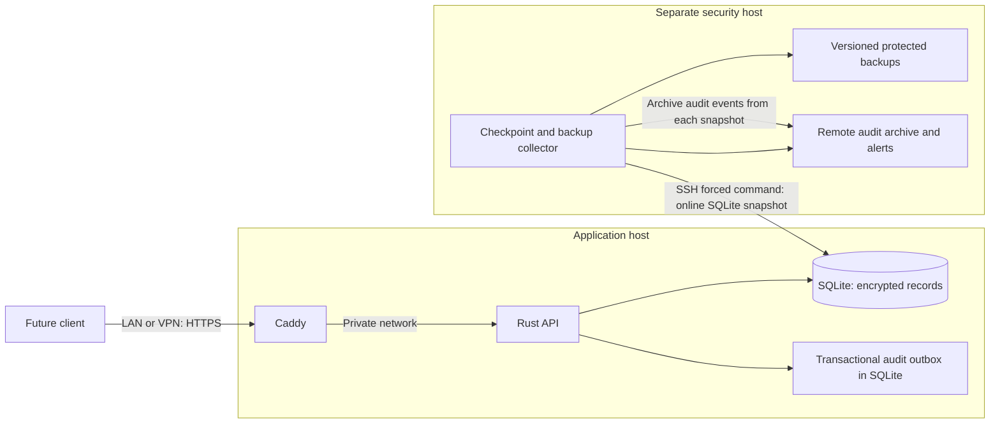
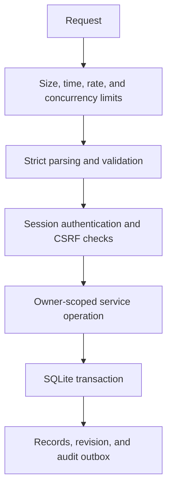

# Backend Architecture

This document describes the target design. An initial implementation now exists in `src/`, `migrations/`, and `scripts/`. The patched Rust build, Clippy, all 27 Rust test executions (one is a subprocess fixture entry point), and all 27 Python tests pass with Rust 1.100. Temporary dependency backports resolve patched SQLite and RSA with zero cached-audit vulnerability findings; an unused chrono maintenance warning remains visible (see README.md and vendor/README.md). The user-run isolated Docker validation passed all ten startup, HTTPS, hardening, permission, snapshot, and restart checks on November 17, 2026; the subsequent encrypted disaster-recovery drill passed all 18 checks, including loss of the source volume, recovery into a fresh volume, and tampering rejection. Production network and operational verification remain separate. It targets a single-user private-network deployment. Rust, Axum, Tokio, SQLx, and SQLite remain the application stack. The revision strengthens authentication, authorization, durability, and independent monitoring. Client implementation and client compromise are outside this document's scope.

## Security Goals and Trust Boundaries

Protect encrypted vault records, account credentials, sessions, and backups against unauthorized network requests, stolen database files, concurrent writes, accidental restoration, and backend resource exhaustion.

Assume an attacker can reach the HTTPS endpoint and submit arbitrary requests. Treat identifiers, headers, ciphertext, and encryption parameters as untrusted. A stolen database must not contain plaintext passwords or vault keys.

A fully compromised application process can bypass its own authorization; a fully compromised host can change local code, data, and logs. Independent backup and monitoring systems therefore use separate hosts and administrative credentials. These controls provide recovery and evidence; they cannot make a compromised backend trustworthy while it continues running.

## Deployment Architecture



Only Caddy publishes an application port, bound to the intended private interface. A host firewall permits approved LAN/VPN ranges. The API and SQLite have no public ports. Use a stable private DNS name and trusted HTTPS certificates; VPN access never replaces application authentication.

Run the API as non-root with a read-only root filesystem, dropped capabilities, resource limits, and a dedicated database volume. Do not mount the Docker socket or backup administration credentials. Keep the reverse proxy's writable certificate storage separate from the application volume.

## Request Processing and Modules



Handlers call explicit authentication and vault services; services use parameterized SQLx queries. No public handler receives unrestricted database access. Use SQLite foreign keys, uniqueness constraints, transactions, WAL mode, and durable synchronization settings; measure performance before weakening durability.

Proposed layout:

```text
src/
  main.rs          # Startup validation and graceful shutdown
  config.rs        # Typed, validated configuration
  api.rs           # Routes, WebAuthn handlers, parsing, limits
  auth/            # In-memory sessions and ceremonies
  vault.rs         # Owner-scoped operations and revisions
  db.rs            # Connections, migrations, transactional audit events
migrations/        # Versioned SQL migrations
tests/            # Integration and security tests
```

## Authentication and Account Recovery

Use **WebAuthn credentials with required user verification** instead of a reusable server login password. Use a maintained server library; verify challenge, signature, operation type, exact allowed origin, RP ID, and user-verification flags. Challenges are random, short-lived, single-use, and bound to their operation and initiating flow. Credential counters are risk signals, not the sole replay defense.

- Create the initial account through a local administrative command and a short-lived, single-use enrollment ceremony. Disable enrollment afterward; no public registration endpoint.
- Enroll a second authenticator before relying on the service. Adding/removing credentials requires fresh authentication with an existing credential; prevent removal of the last credential.
- Provide no email reset, security-question fallback, or password fallback. If all authenticators are lost, explicit local administrative recovery replaces account credentials and revokes every session. It does not unlock the encrypted vault.
- Keep administrative commands outside the HTTP API. Recovery requires access to the host and is recorded in the external audit trail.

Issue random 256-bit opaque session tokens and store only their hashes. For browser use, send a `__Host-` cookie with Secure, HttpOnly, SameSite=Strict, Path=/, and no Domain attribute. Enforce CSRF tokens and exact Origin checks on state-changing browser requests; GET requests never mutate state. Disable cross-origin access by default.

Initial policy: 15-minute idle expiry, eight-hour absolute expiry, immediate logout revocation, and session revocation on credential recovery. Require authentication within the previous five minutes for credential changes, vault-envelope replacement, and vault deletion. Restarting the service invalidates sessions and pending challenges; neither is restored from backups.

## Encrypted Storage Contract

The backend accepts only versioned encrypted vault envelopes and encrypted entries. It never accepts the master password, plaintext entry contents, or an unwrapped vault key. Client cryptography remains a later workstream: Argon2id wrapping-key derivation and XChaCha20-Poly1305 authenticated encryption through established libraries.

Encrypt titles, URLs, usernames, notes, and passwords together. The backend still needs identifiers, ownership, revisions, sizes, and timestamps. Validate format versions, field lengths, nonce lengths, and an allowlist of derivation parameters. Structural validation does not prove ciphertext authenticity: the backend has no decryption key.

| Record | Backend storage |
| --- | --- |
| Account | Identifier and administrative state |
| Credential | Owner, credential identifier, public key, library-required metadata |
| Vault | Owner, encrypted key envelope, salt, nonce, approved parameters, revision |
| Entry | Vault, identifier, ciphertext, nonce, revision, deletion state |
| Audit outbox | Event identifier, operation, affected identifier/revision, timestamp, delivery state |

Sessions and challenges are bounded in-memory state. All persistent queries constrain ownership using the authenticated account; never trust an owner supplied in a request. Apply the same checks to listing, deletion, envelopes, and exports. Use composite constraints to prevent entries referencing another owner's vault.

## Atomic Writes and Replay Handling

Every mutation requires an expected revision. In one transaction, check ownership, compare the revision, apply the change, increment a vault-wide sequence, and append its audit event. Reject stale updates with HTTP 409. A retried committed write cannot apply twice using the old revision.

Keep revisioned deletion tombstones until the documented retention policy permits cleanup. Treat vault-envelope replacement as a revisioned mutation with fresh authentication. Return success only after the database transaction commits. The initial collector pulls and archives the durable outbox with each consistent snapshot, comparing sequence and event identifiers with its previous checkpoint. There is no asynchronous push worker in this release. The outbox is retained in full, and writes fail closed at 100000 events; acknowledged pruning is future work.

A local sequence prevents ordinary stale writes, but cannot prove freshness after the entire database is rolled back. Independent checkpoints address that separate threat.

## Independent Rollback Detection and Recovery

A collector on a separately administered host periodically obtains a consistent snapshot using SQLite's Online Backup API. It records snapshot digest, vault sequence, and collection time in independently protected, versioned storage. The application cannot overwrite or delete retained versions. Use established authenticated transport and storage access controls; do not invent a signing protocol.

The collector alerts on sequence regression, changed data at an already observed sequence, missing expected audit events, and missed collection deadlines. Checkpoint comparison uses a defined canonical vault-state digest, excluding transient delivery metadata. Archived audit records provide evidence for mutations retained until collection; events erased before collection cannot be observed by this periodic mechanism.

Before reopening a restored service, an operator uses `scripts/verify_restore.py` to compare the decrypted snapshot with its independently archived checkpoint, compares that recovery point with the latest checkpoint, records the restoration externally, and restarts with empty session state. A missing checkpoint service blocks completion of restore validation.

**Detection scope:** periodic collection detects discrepancies involving previously observed state. It does not guarantee detection of changes made and erased between observations, or continued correct responses from a fully compromised server. Stronger guarantees would require an independently enforced write authority and a separate distributed consistency design. This initial design makes bounded detection and recovery explicit rather than claiming complete rollback prevention.

## Availability and Operational Controls

- Start with 256 KiB mutation bodies, 100-entry pages, 32 active API requests with two separate health slots, bounded queues, database busy timeouts, and an explicit vault storage quota. Tune through measurements.
- Throttle authentication by source and account, with global caps and temporary backoff. Trust forwarding headers only from Caddy; avoid permanent lockouts that attackers can trigger.
- Enforce limits at both proxy and application boundaries. Reject oversized input before expensive parsing. Reserve capacity for health checks and shutdown.
- Fail startup on invalid configuration, missing migrations, or unsafe production settings. Apply migrations through a separate maintenance command after a verified backup.
- Log event identifiers and outcomes, never session tokens, challenges, vault payloads, or authentication bodies. Disable production debug endpoints and sensitive tracing.
- Monitor disk space, backup age, outbox backlog, and clock health. Stop accepting writes when audit persistence or database commit fails; alert on external audit-delivery failures.
- Back up through the SQLite backup API, never a raw copy of a live WAL database. Encrypt backups for the recovery operator, retain versions, and regularly restore to an isolated environment.
- Pin dependencies and container images; review security advisories and run formatting, linting, tests, and dependency scans before releases. Keep host and container runtimes patched.

## Backend Acceptance Criteria

These are implementation gates, not evidence that tests already passed:

- Reject expired, reused, wrong-origin, and wrong-operation WebAuthn challenges and assertions without required user verification.
- Deny unauthenticated and cross-owner access on every protected route, including batch operations and deletion.
- Verify session expiry, revocation, recovery, restart invalidation, CSRF protection, and credential-enrollment restrictions.
- Verify SQL parameterization, malformed envelope rejection, body/page quotas, login throttling, and bounded resource use under load.
- Exercise concurrent writes, repeated requests, process termination during transactions, full disks, and audit delivery outages.
- Restore consistent backups and demonstrate independent checkpoint regression alerts, missing-checkpoint alerts, and session invalidation after recovery.

## References

- [W3C Web Authentication](https://www.w3.org/TR/webauthn-3/): server-side registration and assertion verification.
- [SQLite Online Backup API](https://www.sqlite.org/backup.html): consistent backups of a live database.

## Resilience Verification Status

Local fault-injection tests now pass for SQLite capacity exhaustion, read-only mode, write-lock contention, audit capacity, cancelled transactions, request deadlines, concurrent updates, and process termination after uncommitted WAL spill. Unavailable storage returns 503; protected operations remain authenticated and failed mutations do not advance revisions or audit state. A separate two-slot liveness budget keeps health independent of stalled API work. The November 17, 2026 user-run combined Docker drill passed all 21 checks: 300 anonymous HTTPS requests yielded 239 unauthorized and 61 rate-limited responses; health remained reachable, committed state survived SIGKILL/restart, encrypted recovery passed, and cleanup succeeded. The agent inspected the report. See README.md for commands and the limits of these tests.
